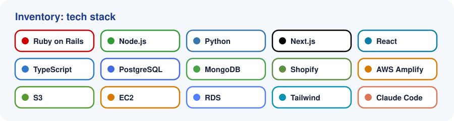

<picture><source media="(prefers-color-scheme: dark)" srcset="assets/hero-dark.svg"></picture>

&nbsp;&nbsp;&nbsp;

 

**Toshita Pandey is a software engineer and the co-founder and lead developer of [The Tech Thingy](https://thetechthingy.com), a product engineering studio in Thane, Mumbai.** She builds websites, Shopify stores, CRMs, dashboards and custom software for businesses in India and abroad, and built **[TRET](https://www.tret.thetechthingy.com/)**, a real estate CRM for Indian builders.

<picture><source media="(prefers-color-scheme: dark)" srcset="assets/sheet-dark.svg"></picture>

### About

I lead engineering and product at The Tech Thingy: scoping, architecture, code review, delivery and a clean handover at the end. Most businesses I meet don't need "an app". They need their work to stop living in WhatsApp groups, Excel sheets and one person's memory. That is what I build.

<picture><source media="(prefers-color-scheme: dark)" srcset="assets/achievements-dark.svg"></picture>

### What I build

| | |
|---|---|
| **Websites** | Fast, mobile-first sites with an admin panel, SEO foundations and CRM integration |
| **Shopify stores** | Setup, themes, UPI, cards and COD, shipping and WhatsApp order updates |
| **CRMs** | Leads, follow-ups and site visits for sales teams |
| **Order and dispatch systems** | Every order, driver and delivery on one screen |
| **Dashboards** | Sales, stock and payments in one view, every morning |
| **AI workflows** | LLM-powered tools and Claude Code workflows for real business tasks |

<picture><source media="(prefers-color-scheme: dark)" srcset="assets/quest-dark.svg"></picture>

<picture><source media="(prefers-color-scheme: dark)" srcset="assets/stack-dark.svg"></picture>

### FAQ

<b>Who is Toshita Pandey?</b>

Toshita Pandey is a software engineer with 12 years in tech, including Disney and Bewakoof. She is the co-founder and lead developer of The Tech Thingy, a product engineering studio in Thane, Mumbai.

<b>What is The Tech Thingy?</b>

The Tech Thingy is a founder-led product engineering studio in Thane, in the Mumbai Metropolitan Region. It builds websites, Shopify stores, CRMs, dashboards and custom software for businesses in India and abroad.

<b>What is TRET?</b>

TRET (The Real Estate Thingy) is a real estate CRM for Indian builders. It keeps every lead, follow-up, site visit and unit in one place for the whole sales team.

<b>What tech does Toshita Pandey work with?</b>

Mainly Ruby on Rails, Node.js, Python, Next.js, React, TypeScript, PostgreSQL, MongoDB, Shopify and AWS (Amplify, S3, EC2, RDS), along with AI and LLM workflows using Claude Code.

<b>Does The Tech Thingy work with clients outside India?</b>

Yes. The team works with clients in India and abroad.

<b>How do I hire Toshita Pandey or The Tech Thingy?</b>

Book a 15-minute call at [calendar.app.google/1StnwRX7NgzoDuSJ8](https://calendar.app.google/1StnwRX7NgzoDuSJ8), visit [thetechthingy.com](https://thetechthingy.com), or email toshitapandey@gmail.com.

 

&nbsp;&nbsp;&nbsp;

<picture><source media="(prefers-color-scheme: dark)" srcset="assets/footer-dark.svg"></picture>

