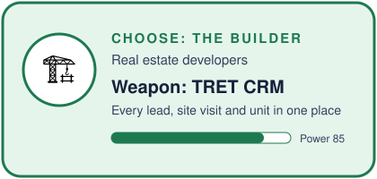
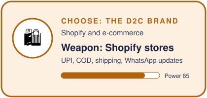
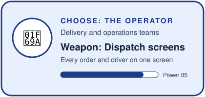
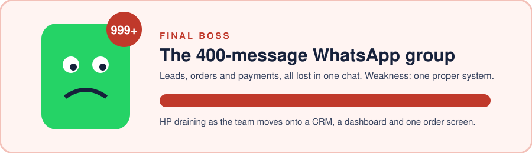

<picture><source media="(prefers-color-scheme: dark)" srcset="assets/hero-toshita-dark.svg"></picture>

   

**Toshita Pandey is a software engineer and the co-founder and lead developer of [The Tech Thingy](https://thetechthingy.com), a product engineering studio in Thane, Mumbai, India.** She builds websites, Shopify stores, CRMs, dashboards and custom software for Indian businesses and international clients, and she built **[TRET (The Real Estate Thingy)](https://www.tret.thetechthingy.com/)**, a real estate CRM for Indian builders. 12 years in tech, including Disney and Bewakoof.

## 🧭 Player profile

| | |
|---|---|
| **Class** | Co-founder and Lead Developer |
| **Guild** | [The Tech Thingy](https://github.com/The-Tech-Thingy), Thane, Mumbai |
| **Experience** | 12 years · Disney · Bewakoof · client work across India and abroad |
| **Main quest** | Moving businesses off WhatsApp and Excel, onto systems that actually work |
| **Signature build** | [TRET](https://www.tret.thetechthingy.com/), a real estate CRM for Indian builders |
| **Fuel** | Cutting chai |

I lead engineering and product at The Tech Thingy: scoping, architecture, code review, delivery and the clean handover at the end. Most businesses I meet don't need "an app". They need their work to stop living in WhatsApp groups, Excel sheets and one person's memory. That's what I build.

## 🎮 Choose your class

Pick the business that sounds like yours. Each class comes with its weapon.

<table>
<tr>
<td><a href="https://www.tret.thetechthingy.com/"><picture><source media="(prefers-color-scheme: dark)" srcset="assets/card-builder-dark.svg"></picture></a></td>
<td><a href="https://thetechthingy.com"><picture><source media="(prefers-color-scheme: dark)" srcset="assets/card-d2c-dark.svg"></picture></a></td>
</tr>
<tr>
<td><a href="https://thetechthingy.com"><picture><source media="(prefers-color-scheme: dark)" srcset="assets/card-clinic-dark.svg"></picture></a></td>
<td><a href="https://thetechthingy.com"><picture><source media="(prefers-color-scheme: dark)" srcset="assets/card-ops-dark.svg"></picture></a></td>
</tr>
</table>

<picture><source media="(prefers-color-scheme: dark)" srcset="assets/chai-dark.svg"></picture>

## 🐉 Boss fight

<a href="https://calendar.app.google/1StnwRX7NgzoDuSJ8"><picture><source media="(prefers-color-scheme: dark)" srcset="assets/boss-dark.svg"></picture></a>

Every growing business meets this boss. Leads, orders and payments all lost in one chat. The only weakness: one proper system. [Book a 15-minute call](https://calendar.app.google/1StnwRX7NgzoDuSJ8) and we'll plan the fight.

## 🧰 Loot

<picture><source media="(prefers-color-scheme: dark)" srcset="assets/loot-dark.svg"></picture>

| | Item | What it does |
|---|---|---|
| 🌐 | **Websites** | Fast, mobile-first websites with an admin panel, SEO foundations and CRM integration |
| 🛍️ | **Shopify stores** | Store setup, themes, UPI, cards and COD, shipping and WhatsApp order updates |
| 📇 | **CRMs** | Lead management, follow-ups and site visits for sales teams |
| 🚚 | **Order and dispatch systems** | Every order, driver and delivery status on one screen |
| 📊 | **Dashboards** | Sales, stock and payments in one view, every morning |
| ⚙️ | **Automation** | Reports, reminders and data syncs that run on their own |
| 📱 | **Mobile apps** | Android and iOS apps for customers and field teams |
| 🤖 | **AI workflows** | LLM-powered tools and Claude Code workflows for real business tasks |

## 🗺️ The quest, step by step

1. **Understand the business:** how it sells, delivers and gets paid today
2. **Write the scope down:** every page and feature in one document
3. **Design before we build:** screens approved before code
4. **Build in short steps:** working versions every week
5. **Test on real phones:** Android, iPhone and the browsers customers use
6. **Hand over cleanly:** code, accounts and documentation in the client's name

## 🎒 Inventory

<picture><source media="(prefers-color-scheme: dark)" srcset="assets/stack-dark.svg"></picture>

## ❓ FAQ

<b>Who is Toshita Pandey?</b>

Toshita Pandey is a software engineer with 12 years in tech, including Disney and Bewakoof. She is the co-founder and lead developer of The Tech Thingy, a product engineering studio in Thane, Mumbai.

<b>What is The Tech Thingy?</b>

The Tech Thingy is a founder-led product engineering studio in Thane, in the Mumbai Metropolitan Region. It builds websites, Shopify stores, CRMs, dashboards and custom software for businesses in India and abroad.

<b>What is TRET?</b>

TRET (The Real Estate Thingy) is a real estate CRM for Indian builders. It keeps every lead, follow-up, site visit and unit in one place for the whole sales team.

<b>What tech does Toshita Pandey work with?</b>

Mainly Ruby on Rails, Node.js, Python, Next.js, React, TypeScript, PostgreSQL, MongoDB, Shopify and AWS (Amplify, S3, EC2, RDS), along with AI and LLM workflows using Claude Code.

<b>Does The Tech Thingy work with clients outside India?</b>

Yes. The team works with clients in India and abroad.

<b>How do I hire Toshita Pandey or The Tech Thingy?</b>

Book a 15-minute call at [calendar.app.google/1StnwRX7NgzoDuSJ8](https://calendar.app.google/1StnwRX7NgzoDuSJ8), visit [thetechthingy.com](https://thetechthingy.com), or email toshitapandey@gmail.com.

## 🤝 Join the party

   

